  

  
  
  

## 👋 About

I'm a **technology-for-development practitioner** with 6+ years across software, analytics, project delivery and entrepreneurship. I build the systems behind **clean energy, water access, e-mobility and inclusive finance**, from the data model and ETL pipelines to the dashboards and apps people actually use.

> *Insight is only useful when it moves work forward.*

|  |  |
|---|---|
| 🧭 **Now** | Full Stack Developer, Business Data Analytics & Project Controls at **WE!Hub Victoria (WeTu)**, supporting 12 sites |
| 🛠️ **Building** | Self-hosted **Metabase** on Linux and Docker, Python ETL, Laravel/Filament apps, M-Pesa/Daraja integrations |
| 🚀 **Ventures** | **TankNow** (Founder) · **Bionala** (Co-Founder & CTO) · **Teryx** (Technical Lead, Data & Systems) |
| 📚 **Learning** | Java & Spring Boot, Angular, Flutter for mobile |
| 📍 **Based in** | Kisumu / Nairobi, Kenya |

## 🧰 Tech stack

<table>
  <tr>
    <td width="170"><b>Data & analytics</b></td>
    <td>&nbsp;&nbsp;&nbsp;&nbsp;&nbsp;&nbsp;&nbsp;&nbsp;&nbsp;&nbsp;&nbsp;&nbsp;&nbsp;</td>
  </tr>
  <tr>
    <td><b>Web & software</b></td>
    <td>&nbsp;&nbsp;&nbsp;&nbsp;&nbsp;&nbsp;&nbsp;&nbsp;&nbsp;&nbsp;&nbsp;&nbsp;&nbsp;&nbsp;&nbsp;&nbsp;&nbsp;&nbsp;&nbsp;&nbsp;&nbsp;&nbsp;</td>
  </tr>
  <tr>
    <td><b>Mobile</b></td>
    <td>&nbsp;&nbsp;</td>
  </tr>
  <tr>
    <td><b>Infrastructure</b></td>
    <td>&nbsp;&nbsp;&nbsp;&nbsp;&nbsp;&nbsp;&nbsp;&nbsp;</td>
  </tr>
</table>

## 📌 Selected work

| Project | What it does | Stack |
|---|---|---|
| [**NutriPal Recipe Recommender**](https://github.com/Mugangasia/NutriPal-Recipe-Recommendation-System-) | Personalised nutrition recommendations using content-based and collaborative filtering on global and Kenyan recipe data | Python · Jupyter |
| [**Wind Energy Location Selection**](https://github.com/Mugangasia/Capstone-Project---Predicting-Best-Location-for-Wind-Energy-in-Kenya) | Time-series models ranking six Kenyan regions for wind-power potential | Python · Jupyter |
| [**Microsoft Stock Forecasting**](https://github.com/Mugangasia/Time-Series-Analysis---Predicting-Microsoft-Stock-Prices-) | ARIMA, LSTM and Prophet compared for forecasting stock prices | Python · Jupyter |
| [**Car Price Prediction**](https://github.com/Mugangasia/car-prediction-model/blob/master/car-price-prediction-linear-regression-rfe.ipynb) | Regression with recursive feature elimination to find what drives car prices | Python · scikit-learn |
| [**Live analytics dashboards**](https://mugangasiabravin.tech/projects) | Embedded Metabase dashboards on real data, with the stack behind them | Metabase · SQL · Laravel |

More on the [portfolio](https://mugangasiabravin.tech) and [field notes](https://mugangasiabravin.tech/insights).

## 🎓 Certifications

<table>
  <tr>
    <td align="center" width="25%"> <b>Google</b> Data Analytics</td>
    <td align="center" width="25%"> <b>DataCamp</b> Data Analyst Associate</td>
    <td align="center" width="25%"> <b>CFI</b> Financial Modeling & Valuation (FMVA)</td>
    <td align="center" width="25%"> <b>freeCodeCamp</b> Responsive Web Design</td>
  </tr>
</table>

Also: Applied Data Science Lab (WorldQuant University) · Data Science & Machine Learning (Moringa School) · B.Com Accounting (Machakos University).

## 📈 GitHub activity

  <picture>
    <source media="(prefers-color-scheme: dark)" srcset="https://streak-stats.demolab.com/?user=Mugangasia&theme=dark&hide_border=true&background=00000000" />
    
  </picture>

## 🤝 Let's work together

I take on **data systems, self-hosted BI, web and mobile builds**, and technology projects with social impact. The fastest way to reach me is [email](mailto:bravinmugangasia@gmail.com) or [LinkedIn](https://www.linkedin.com/in/bravinmugangasiaprofile/).

Built around data, clarity and impact · <a href="https://mugangasiabravin.tech">mugangasiabravin.tech</a>

